# UI pass, 0.1.0 to 0.2.4

Screenshots and notes for the design passes that followed
[DESIGN-REVIEW.md](../../DESIGN-REVIEW.md). Pictures up to round four are the
app at `localhost:1420` in its default preset (hue 264, dark), captured at
836 x 1216 so the pairs line up. From round five the pictures are the packaged
window, and they say so.

To reproduce: `npm run dev`, open the tab in the pair, and compare.

## Remapper

| Before | After |
| --- | --- |
| 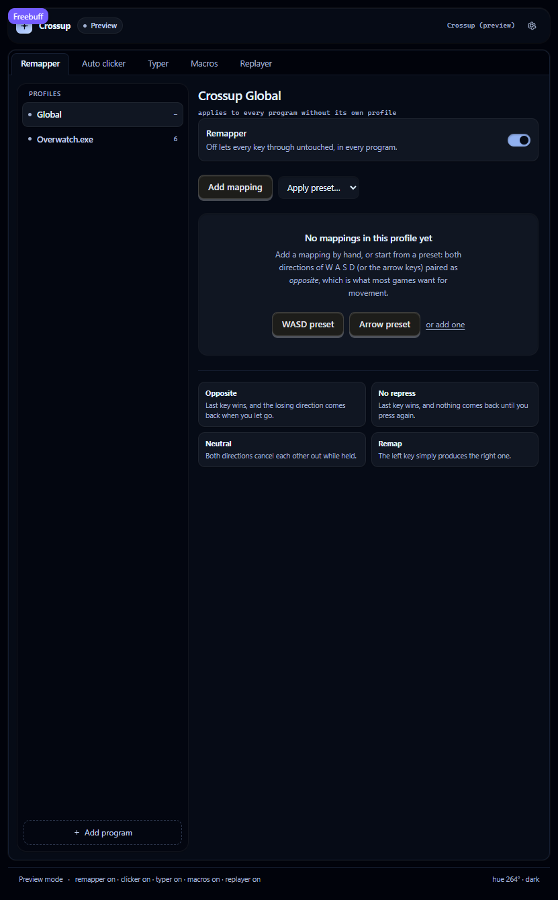 | 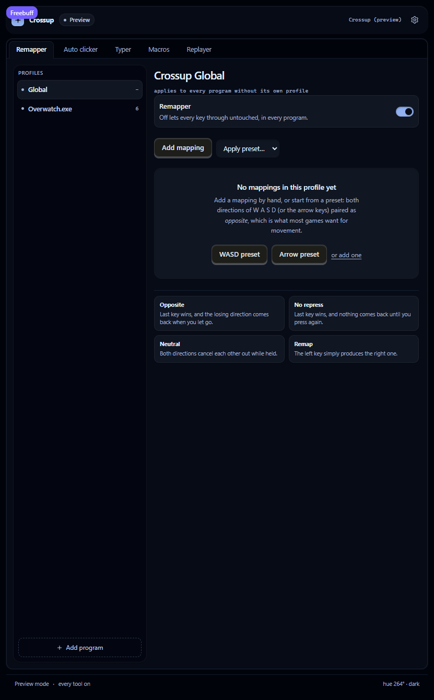 |

The table and its empty state are still the screen. What changed is underneath:
spacing snapped to the 6/8/10 scale, the footer stopped being five switch states
in a row, the profile rail reads `live` instead of a mapping count for the
program in front, and the brand mark is a flat accent square rather than a
gradient.

## Auto clicker

| Before | After |
| --- | --- |
| 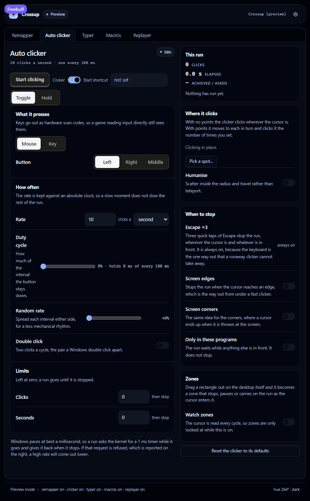 | 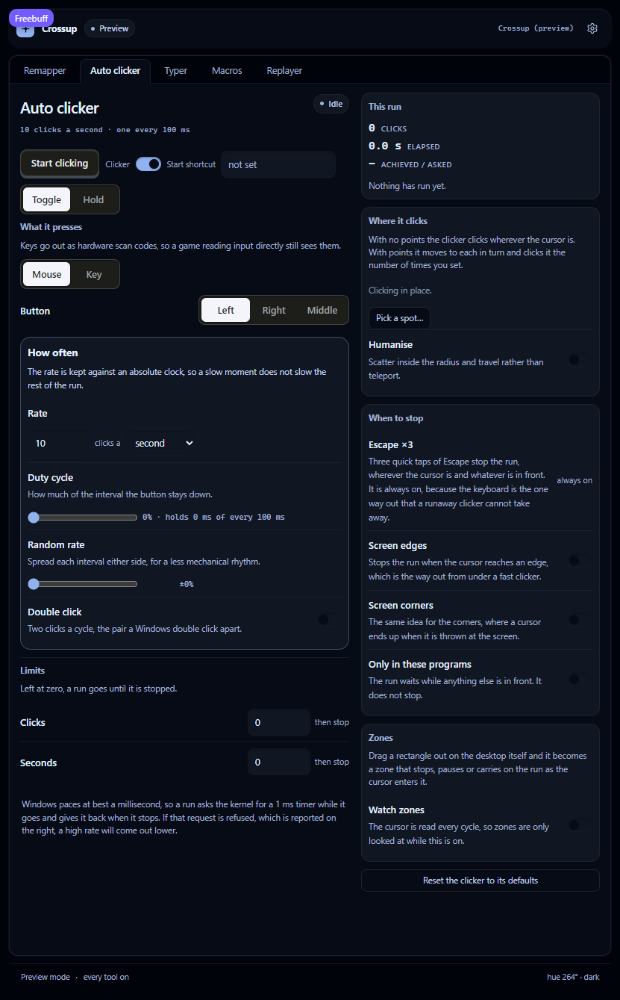 |

Three changes, one of them a real fault. The "Duty cycle" row used to collapse
its label to one word per line, because a long note and a wide control were
fighting for the same 300px; rows now wrap the control under the label instead.
"How often" became the tab's one raised surface. The side readouts kept their
own surfaces, because unboxed numbers floated next to the page.

## Typer

| After | |
| --- | --- |
| 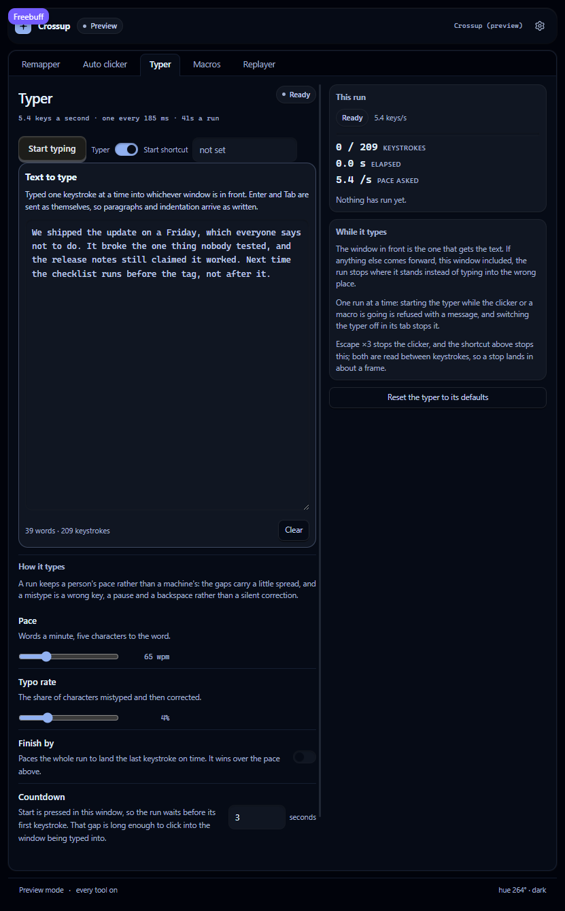 | |

The draft is the lifted panel on this tab, which is where the pointer and the
eye should land first. The rest of the tab is a quiet group.

## Replayer

| Before | After |
| --- | --- |
| 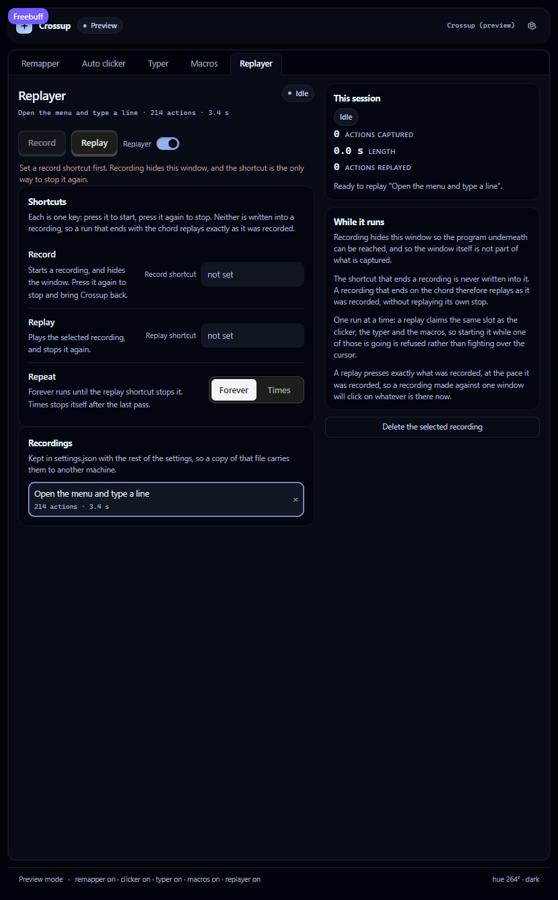 | 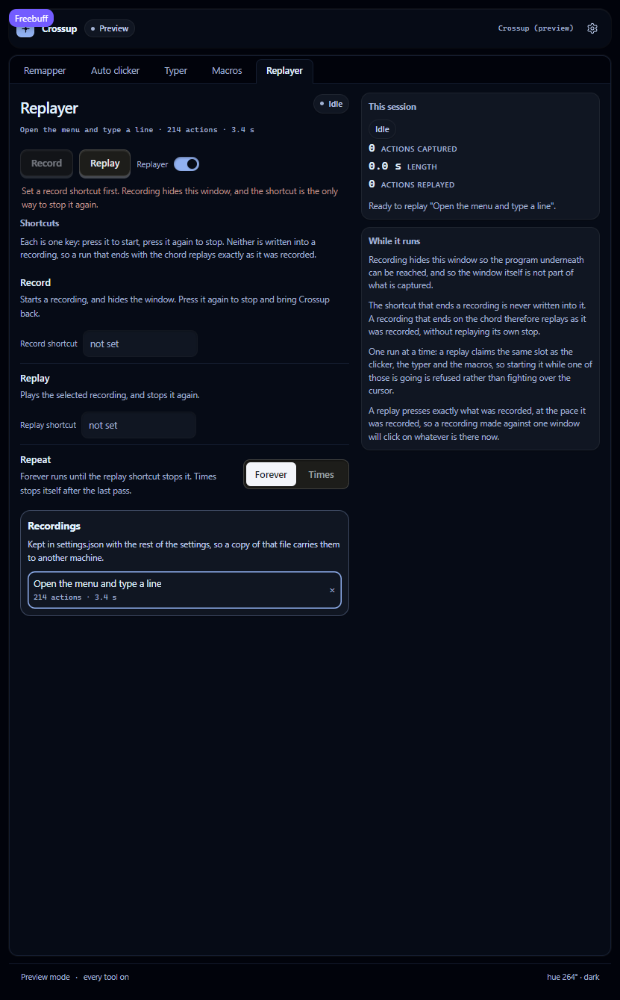 |

The recordings list is the surface now, and the redundant "Delete the selected
recording" button is gone.

## Settings

| Before | After |
| --- | --- |
| 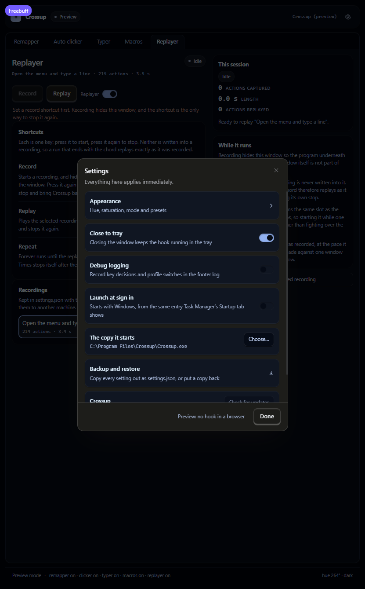 | 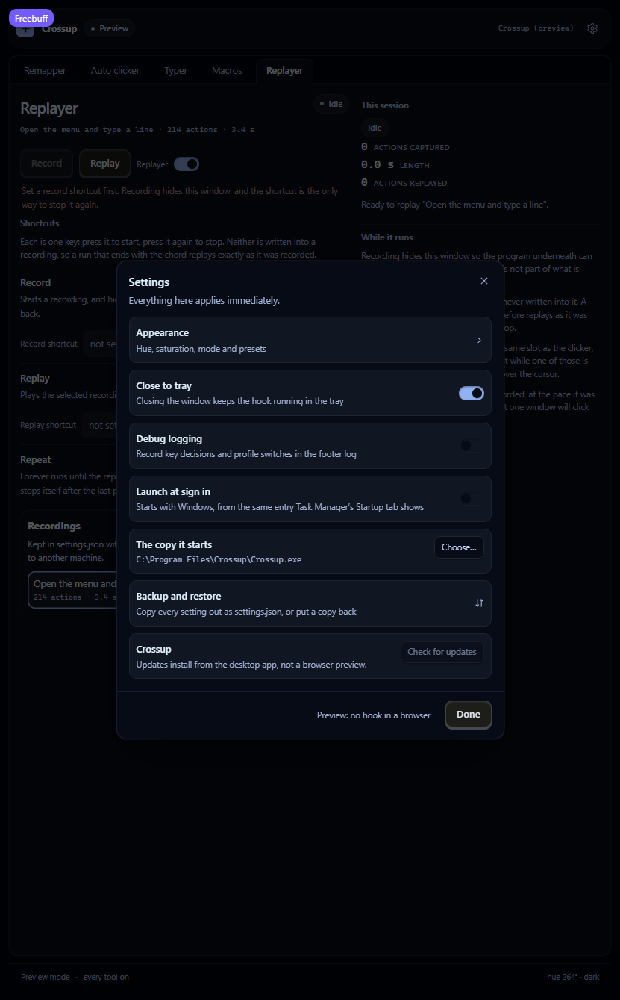 |

The dialog was clipping its last row behind the footer; it is 520 wide and 86vh
tall now, so every row, including the update row, fits. The dialog also stopped
borrowing Interior.dev's stone palette and reads the app's own tokens, which is
why it no longer keeps a blue-teal cast when the hue slider moves.

## Round three: the title row pins, deletes come back

### Sticky title row

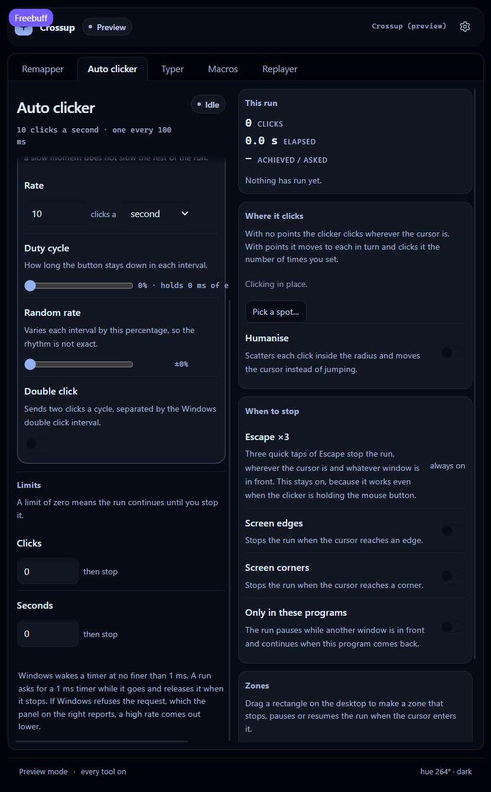

The clicker at full scroll (the page is zoomed to 125 percent so the column
overflows at this window size). The column has scrolled 421 of 421 pixels and the
title row is still at the top of it. The measurement taken at capture time:
`headTop 150`, `pageTop 150`, `scrollTop 421` of `max 421`. Unstuck, the header
would have been 271px above the viewport.

The row is `position: sticky` on `.hb__head`, with a solid `--panel` background
and a 12px fade strip under it via `::after`. The first attempt used a gradient
behind the header instead, and the row sliding underneath showed through the
subtitle, which is visible in the discarded take: the fix was to make the header
itself opaque and move the fade below it. All five tabs use the same row, so the
tool name and its state pill stay in view everywhere.

### Undo instead of a confirm

| Recording | Macro |
| --- | --- |
| 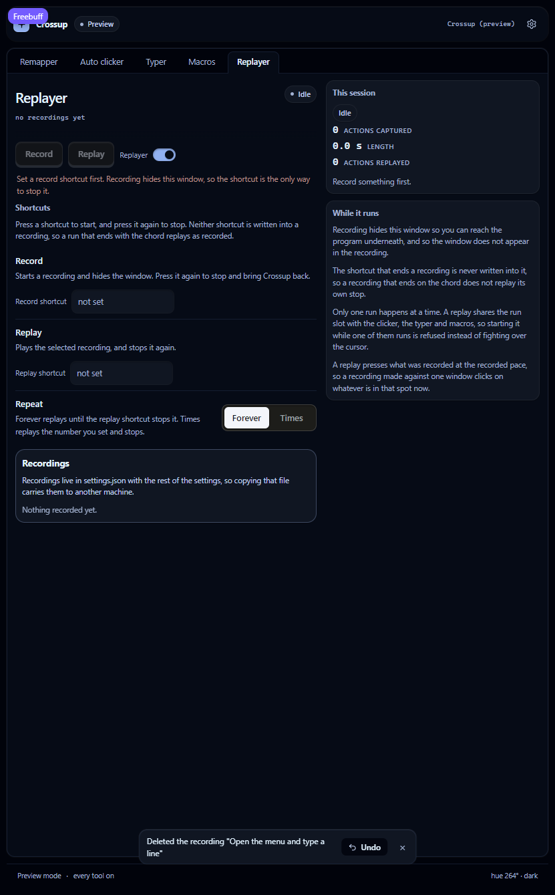 | 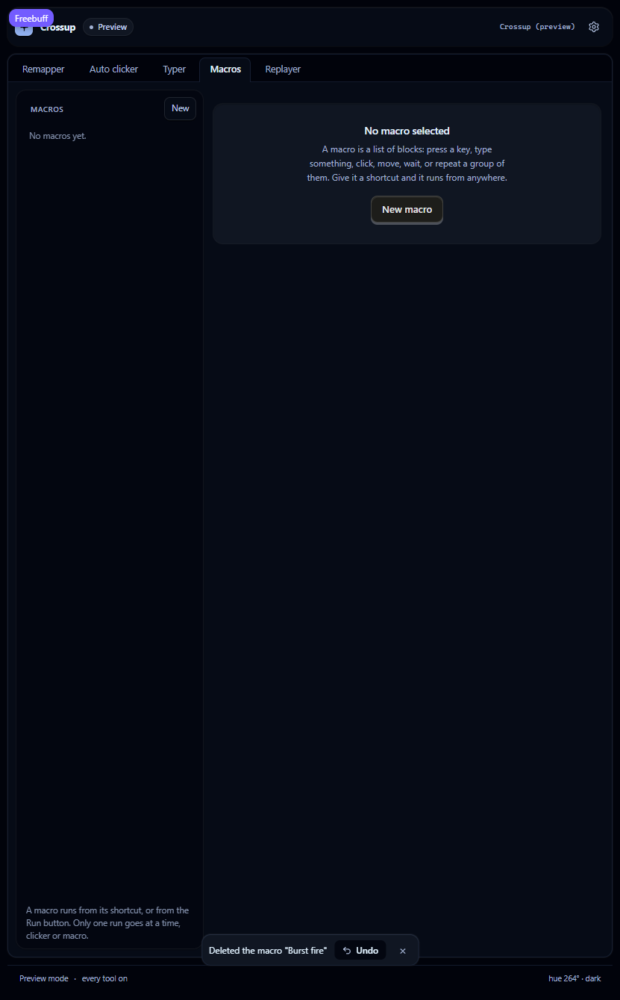 |

The delete happens immediately, and the bar offers it back for twelve seconds.
Ctrl+Z does the same thing. Both screenshots show the item gone (the list is
empty, "No macro selected") with the offer on screen.

Verified after pressing Undo, not just before: the recording list went back to
one row, the subtitle went back to `Open the menu and type a line · 214 actions ·
3.4 s`, and the bar cleared. The macro path was checked the same way: the macro
list came back with the macro in it.

The engine keeps one undo slot, holding the removed item, the index it sat at and
the selection that went with it, so a recording returns to its place and stays
selected. The window never holds a recording's events, which is why the restore
lives in Rust rather than in the tab.

## Round five: type and measured contrast

These pictures are the packaged window, not the dev server: the binary from
`tauri build --no-bundle`, captured from its own WebView2 window at 1120 x 760.

| Packaged, Remapper | Packaged, Auto clicker |
| --- | --- |
| 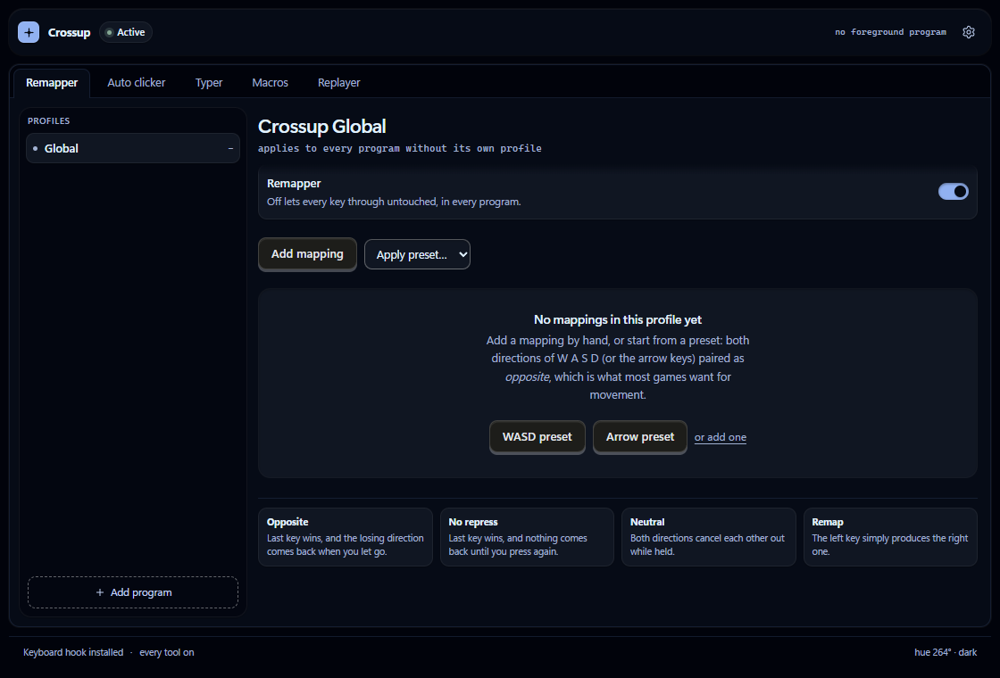 | 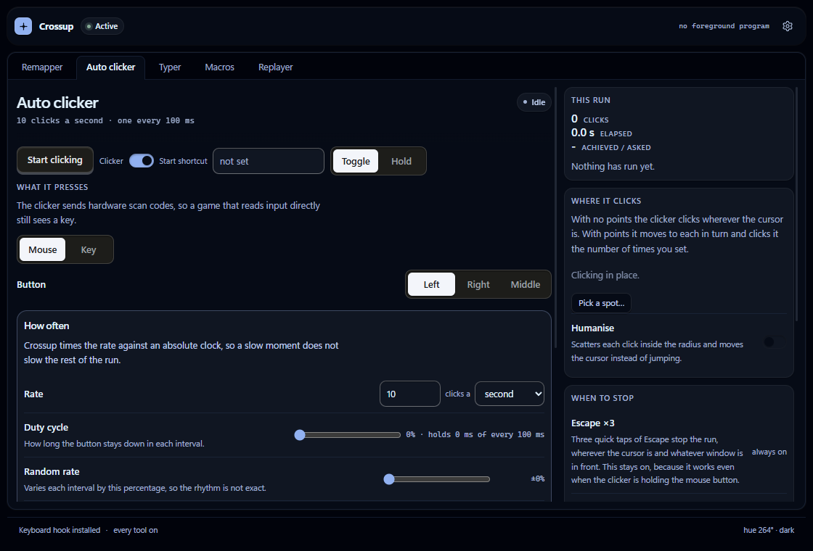 |

| Packaged, Macros | Packaged, light mode |
| --- | --- |
| 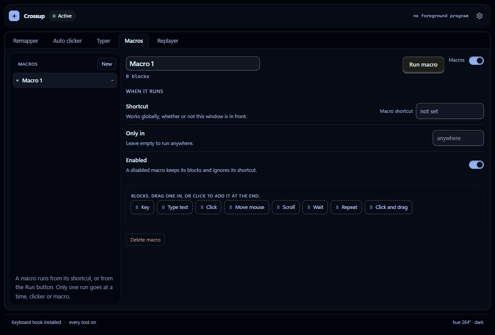 | 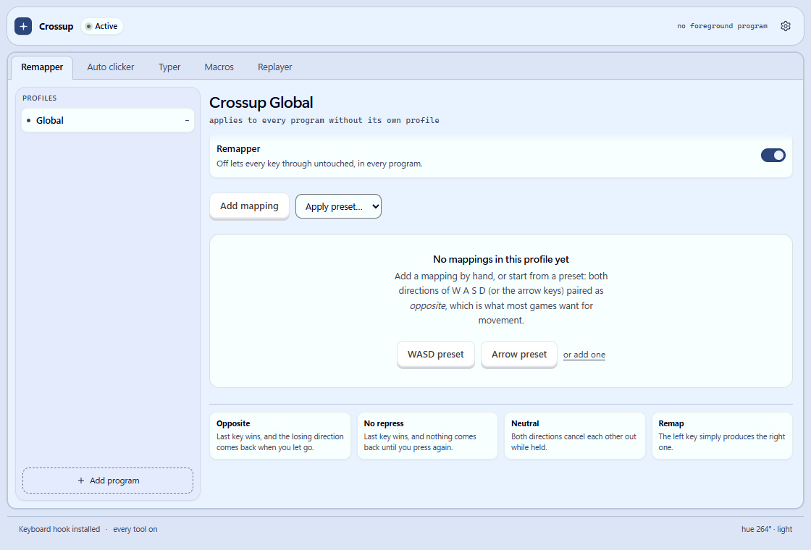 |

The packaged run also caught a bug the mock could not: opening Replayer blanked
the window, because the engine sent `record_hotkey` where the tab read
`recordHotkey`. The two view structs now serialize camelCase, and the pictures
above are from the build that has the fix.

What changed on screen: a 22px display line with `-0.03em` tracking, card labels
set in 10.5px caps with 0.085em between letters, notes at 12.75px on a 1.6 line
and capped at 64 characters, figures at 16px on the display face, and counters
that keep their width while they run because the numerals are tabular. Text
fields and the add button carry a one-pixel edge you can actually see.

### The numbers

Each computed colour was painted into a one-pixel canvas and read back, so
`oklch` and `color-mix` are measured as rendered; backgrounds are composited up
the ancestor chain. Ratios use the WCAG 2.1 relative-luminance formula.

| Pair | Dark | Light | Needs |
| --- | --- | --- | --- |
| body ink / panel | 17.19 | 17.49 | 4.5 |
| secondary ink / panel | 12.80 | 13.19 | 4.5 |
| muted ink / panel | 9.12 | 8.23 | 4.5 |
| muted ink / well | 8.39 | 9.15 | 4.5 |
| accent / panel | 9.15 | 8.27 | 4.5 |
| danger / panel | 7.21 | 5.44 | 4.5 |
| success / panel | 7.51 | 5.20 | 4.5 |
| control edge / panel | 3.51 | 3.61 | 3 |
| control edge / well | 3.57 | 3.68 | 3 |
| focus ring / panel | 9.15 | 8.27 | 3 |

The first run found one AA failure. The dashed add-button border and the
one-pixel field edges used `--hairline-strong` at 1.63:1 in the dark and 2.35:1
in the light, under the 3:1 a control boundary needs; the palette computes that
token at runtime, so the stylesheet fallback could not fix it. A dedicated
`--edge` token now carries 3.51 and 3.61, and every control edge uses it. The
table above is the run after the fix.

## Round four: undo restores the view, not just the row

| Macro after Undo | Recording after Undo |
| --- | --- |
| 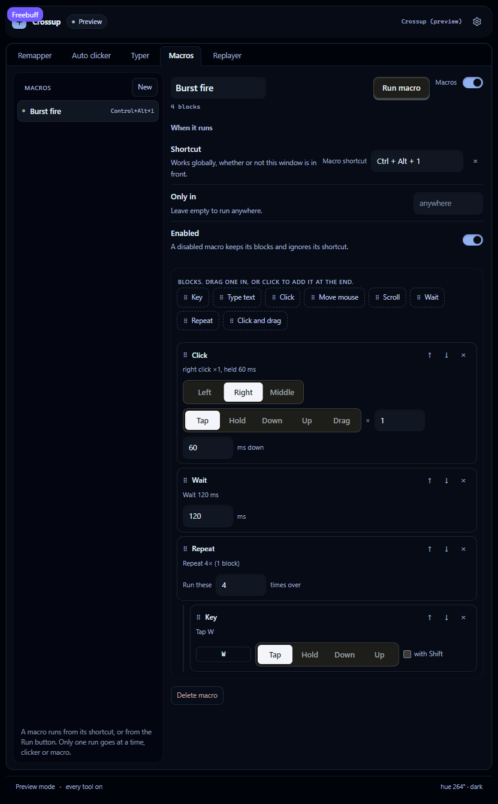 | 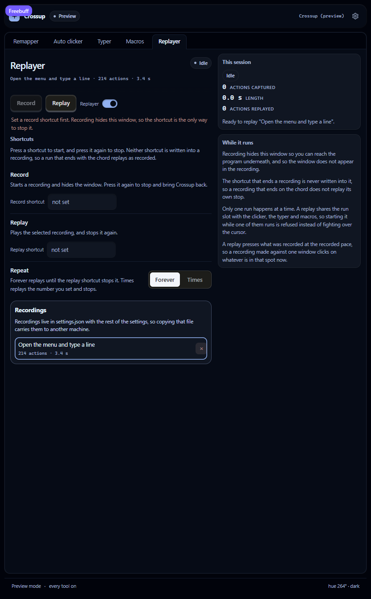 |

Measured from the rendered state after pressing Undo: the macro name field reads
`Burst fire`, the rail row is current, and the empty state is gone. The recording
list holds one row, that row is `aria-current`, and the subtitle reads
`Open the menu and type a line · 214 actions · 3.4 s`.

The fault was in the tab, not the engine. The delete cleared the selection, and
the effect that adopts the selected macro skips a definition equal to the last
one it sent. A restored macro is exactly that, so the page stayed on the empty
state with the macro sitting in the rail. Clearing the last-sent marker when the
selection empties lets the restored macro be adopted.

Clicker row deletes now go through the same bar and put the whole draft back, so
a removed point, zone or program entry returns with the rest of the settings
untouched. Bulk Clear buttons are resets and carry no undo; the review says why.

The sticky header was re-measured on this build (`position: sticky`, header and
page both at 150 at full scroll), so the round-three evidence still stands.

## Criteria, scored

| Criterion | Score | Evidence |
| --- | --- | --- |
| Typography | 9.5 / 10 | One six-step ramp: 22 display, 16 figure, 12.75 body, 11.5 control, 10.5 label, 9.5 micro. Segoe UI Variable Display for titles and figures, Text for running copy, 1.6 leading with a 64ch measure, 0.085em on caps labels, tabular figures wherever a number moves. Half off because the mono subtitle still sets a sentence. |
| Spacing rhythm | 9.5 / 10 | `grep` for 11 to 15px gaps, paddings and margins in `app.css` returns nothing; the shell, brand, rail head, table row, pills, builder and undo bar all moved on scale this pass. |
| Contrast | 9.5 / 10 | Measured from rendered pixels in both modes: weakest text pair 5.20:1, weakest body pair 8.23:1, control edges 3.51 to 3.68:1. The one failure found (1.63 to 2.35:1 on dashed and field edges) was fixed with a dedicated `--edge` token. |
| States | 9.5 / 10 | Empty states name the next action, the boot frame is a skeleton, errors use `role="status"`, disabled buttons fade to 50 percent, focus is the 2px accent ring from `styles.css`. Delete now has a recovery state rather than a question. |
| Motion | 9 / 10 | Press depth, panel lift, a 160ms undo slide. Reduced motion is handled in the tab strip and in the undo bar's media query. |
| Hierarchy | 9.5 / 10 | One lead surface per tab, hairline groups elsewhere, and a title row that stays put while the controls move. |
| Reversibility | 9.5 / 10 | Every row delete is undoable: recording, macro, mapping, click point, zone, program entry and macro block. Undo puts the item back and restores the view around it, including the open macro and the selected recording. |
| Copy | 9.5 / 10 | The unslop pass rewrote 86 strings; remaining middle dots join two short values only. |

Overall 9.5 / 10, with typography as the reason it is not a ten.

## What changed, in one list

- One lead surface per tab: the mappings table, "How often", the typer draft, the
  recordings list, the macro builder. Everything else is a quiet group.
- Spacing: every `gap`, `padding` and `margin` in `app.css` on the 6/8/10 scale.
- Palette: the tab strip, the modal and the dialogs read the app's tokens
  instead of `stone-*` and `#4568FF`.
- Icons: `lucide-react` at one stroke weight, replacing six hand-drawn SVGs.
- Boot: a skeleton frame shaped like the window.
- Footer: names the tools that are off instead of five on/off pairs.
- Deletes: immediate, with one undo slot and Ctrl+Z.
- The title row pins to the top of the page column and gains a fade under it.
- The brand mark is flat `--accent`; preset swatches are solid colour with a
  second tone ring rather than a 135 degree gradient.

## Left alone, on purpose

- The hue and chroma slider tracks keep their gradients. They are the control's
  data, not decoration: a hue slider without a spectrum is a worse control.
- Middle-dot readouts stay where they join exactly two short values
  (`214 actions · 3.4 s`).
- Typography is still the system stack. The app is read at 10 to 13px, where the
  system stack is the more legible choice, and a display face is a larger change
  than these passes.
